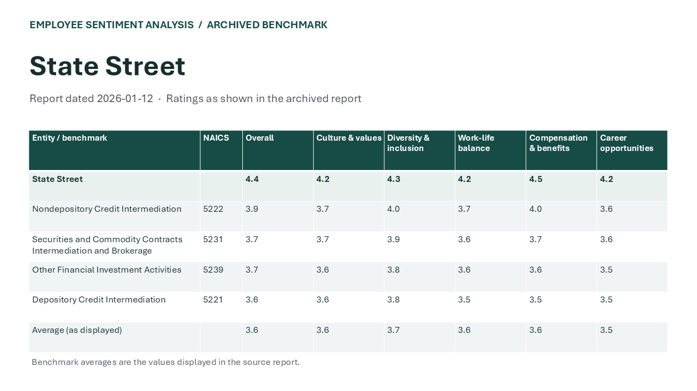

# Employee Sentiment Analysis Core Pipeline

This public workflow takes a CSV of aggregate survey counts, checks that every company–quarter–topic appears once, separates the focus company from its peers and generates an editable PowerPoint. It uses a new schema, fictional data and a neutral presentation design.

```sh
python -m pip install -r requirements.txt
python pipeline.py examples/responses.csv --focus "Alder Works" --output output
```

The example reconciles 36 observations across four topics. For growth opportunities, Alder Works has 159 favorable answers out of 288 and pooled peers have 518 out of 756. The gap is −13.3 percentage points. See the [example summary](examples/summary.json) and [editable comparison](examples/comparison.pptx). [Related repositories](https://github.com/search?q=user%3AMRodriguez2010+topic%3Aemployee-sentiment-analysis&type=repositories)

## Historical source examples

[State Street and Trihydro benchmark slides](public-data/historical-benchmarks.pptx) retain the archived January and March 2026 values in editable, unbranded tables. A separate [April ratings workbook](public-data/ratings-snapshot.xlsx) contains 40 rating observations and 40 distribution rows. [Source notes and CSV fields](public-data/README.md). The two historical data sets are independent of the fictional favorable-response pipeline demonstration.


